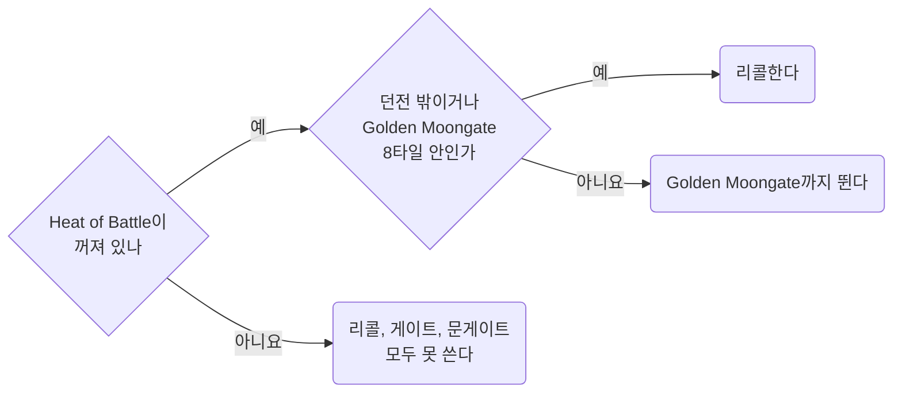

템플릿과 무관한 PvP 서버 규칙과 숫자. 위키와 패치노트 원문 인용, 해석은 인용 아래.
인게임 확인은 표시, 미확인은 "확인되지 않았다".
방어와 회복은 [Combat](../mechanics/combat.md), 근접은 [Melee](../mechanics/melee.md), 주문전은 [PvP Magery](pvp-magery.md).
공통 자기관리 루프는 [PvP Loop](../loops/pvp.md).

- Bard Necro의 판단(Defensive Barding, 도주와 반격, Herding 대신 Resist): [Bard Necro](../templates/bard-necro.md#04) 04절
- 벌목 겸 PvP 템플릿의 스킬, 스탯, 도끼 선택, 교전 분기: [Lumberjack PvP](../templates/lumberjack-pvp.md)
- PvP에서 막히는 스크립트 명령: [Razor](../scripting/razor.md#07) 07절
- 2026-10-22 전투 메커니즘과 공통 루프를 [Combat](../mechanics/combat.md), [PvP Loop](../loops/pvp.md)로 분리

## <a id="00"></a>00 한눈에

| 절 | 내용 |
| --- | --- |
| [01](#01) | PK 공격 시 막히는 것 |
| [02](#02) | 명중률 결정 방식 |
| [03](#03) | Hamstring 구속 시간과 재사용 대기 |
| [04](#04) | Telekinesis와 폭발 포션 대응 |
| [05](#05) | 주문전 상세 문서의 위치 |
| [06](#06) | PvP에서 소환수가 약한 이유 |
| [07](#07) | 자주 틀렸던 생각 |
| [08](#08) | 출처 |

이 문서에 걸린 질문은 [Open items](../questions/open-items.md).

::part[서버 규칙]

## <a id="01"></a>01 공격적 행동과 Heat of Battle

**다른 플레이어에게 공격적 행동 → Heat of Battle.** 켜진 동안 리콜, 게이트, 문게이트, 여관 방 불가.
바드는 Defensive Barding도 잃음([Barding](../mechanics/barding.md#02.I) 02.I절) → 바드의 방어 숫자(02.C절, [Combat](../mechanics/combat.md#04) 04절)는 Heat of Battle 여부로 갈림.

### <a id="01.A"></a>01.A 무엇이 켜는가

**PK 공격 중 Heat of Battle 예외는 자동 반격 스윙 하나.** 누가 나를 칠 때 캐릭터가 저절로 되받아치는 스윙.
타겟 변경, 훔치기, 해로운 주문은 상대가 먼저 쳤어도 켜짐.

> "Heat of Battle will be triggered by performing an aggressive action against another player regardless of notoriety, or when interacting with various faction content events or wayposts."
> "Aggressive actions include attacking or stealing from a player"
> "Aggressive actions do not include retaliatory empty-handed wrestling attacks or weapon swings your character makes when someone attacks you"
> "However, it is an aggressive action to re-target your attacker (for example, to avoid attacking monsters instead of the attacking player)"
> "Note also that using harmful spells (such as Weaken, Telekinesis, or Energy Bolt) will trigger Heat of Battle, even when used against an attacker"
> "Heat of battle will prevent the player from utilizing any moongates, recalling, or entering an inn room while it is active"

| 내 행동 | Heat of Battle |
| --- | --- |
| PK의 공격에 대한 자동 반격 스윙 | **안 켜짐** |
| 몹을 치다 PK로 타겟 변경 | **켜짐.** 위키 예시 |
| 해로운 주문(Energy Bolt, Weaken, Telekinesis 등) | **켜짐.** 상대가 먼저 쳤어도 |
| 플레이어에게서 훔치기 | **켜짐** |
| 팩션 콘텐츠 이벤트, waypost 상호작용 | **켜짐** |
| Hamstring을 켠 자동 반격 스윙 | 확인되지 않았다 |
| 나에게 거는 Telekinesis | 확인되지 않았다(04.A절) |
| 내 소환수의 PK 공격 | 확인되지 않았다(06.A절) |

**"반격은 안 켜짐"은 자동 스윙에만 해당.** 사냥 중엔 몹을 치는 중 → PK를 치려면 타겟 변경 → 그 순간 켜짐.
거리를 두는 메이지 PK에게는 자동 스윙이 나갈 일 자체가 없음.

### <a id="01.B"></a>01.B 지속시간

**빨강, 회색, 주황 공격 30초. 파랑 공격으로 Criminal이면 2분.** 지속시간은 위키에 없고 2020-09-28 패치 원문에만.

> "When any player commits a hostile action (including stealing) to another player, but the action is not considered a criminal action (such as attacking or stealing from a Red, Grey, or Orange
> player) they will have a 30 second Heat of Battle timer started"
> "When any player commits any Criminal action, they have will have a 2 minute Heat of Battle timer started that matches their Criminal Timer duration"
> "Heat of Battle now has a maximum duration of 5 minutes, regardless of circumstance"

| 내 행동 | Heat of Battle |
| --- | --- |
| 빨강, 회색, 주황 플레이어에게 공격적 행동 | 행동마다 **30초** 타이머 시작 |
| 파랑 공격으로 Criminal | **2분.** Criminal 타이머와 같음 |
| 모든 경우 | 최대 **5분** |

### <a id="01.C"></a>01.C 던전 리콜은 Golden Moongate 곁에서만

**던전 안 리콜은 Golden Moongate 8타일 안에서만.** Heat of Battle이 켜져 있으면 그곳에서도 리콜, 게이트, 문게이트 불가.

> "Within dungeons, players may only cast Recall within 8 tiles of a Golden Moongate" -- Magery (Recall)
> "Any character can cast this spell from a scroll in a rune book or rune tome, or from a scroll onto a loose marked rune, even with 0 Magery skill" -- Magery (Recall)
> "When a player is in the Heat of Battle they are unable to cast Recall, Gate, or use any Moongates" -- Magery



- 룬북 리콜은 Magery 0으로도 가능
- 던전에서 PK를 만나면 Golden Moongate까지 도주. 가는 길에 PK에게 공격적 행동 → Heat of Battle → 그 문게이트도 불가
- 먼저 공격하지 않은 바드는 그동안 Defensive Barding으로 버팀(02.C절)
- 리콜도 시전. 시전 중 근접 한 대나 해로운 주문에 끊김(02.E절, 05절)

## <a id="02"></a>02 명중률

**명중률 = 양쪽이 지금 손에 든 것의 스킬 대결.** 다른 스킬은 판정 밖.

> "The chance to hit with a mace class weapon is equal to (attacker's mace fighting skill + 50) / ((defender's weapon or wrestling skill + 50) \* 2)
> plus any relevant accuracy bonuses" -- Mace Fighting
> "The chance to hit and defend with fists (avoiding interrupts while casting) is equal to (attacker's wrestling skill + 50) / ((defender's weapon or wrestling skill + 50) \* 2) plus any relevant
> accuracy bonuses." -- Wrestling
> "Due to Wrestling's defense bonus being active when unarmed (or when holding a spellbook) it can be used to defend against melee attacks while casting spells." -- Wrestling

Swordsmanship도 같은 꼴.

```
명중률 = (공격자 스킬 + 50) / ((방어자 스킬 + 50) x 2)
```

|  | 쓰이는 스킬 |
| --- | --- |
| 공격자 | 든 무기의 스킬. 맨손이나 레슬링 무기면 Wrestling |
| 방어자 | 든 무기의 스킬. 맨손이나 스펠북이면 Wrestling |

### <a id="02.A"></a>02.A 스킬 대 스킬, 명중 보너스 0

| 공격 \\ 방어 | 0 | 50 | 80 | 100 |
| --- | --- | --- | --- | --- |
| **0** | 50% | 25% | 19.2% | 16.7% |
| **50** | 100% | 50% | 38.5% | 33.3% |
| **80** | 100% | 65% | 50% | 43.3% |
| **100** | 100% | 75% | 57.7% | 50% |

- **같은 숫자끼리는 언제나 50%**
- 방어 0이면 공격 50은 정확히 100%, 80과 100은 공식값이 1 초과(130%, 150%). 표에는 100%

### <a id="02.B"></a>02.B 내가 칠 때

**메이지 PK를 칠 때 내 쪽 판정은 손에 든 무기의 스킬만.** 내 레슬링은 레슬링으로 칠 때만.

| 나 (손에 든 것) | 상대 (손에 든 것) | 계산 | 명중 |
| --- | --- | --- | --- |
| 메이스 100 | 무기 100 | 150 / 300 | 50% |
| 맨손, 레슬링 100 | 맨손, 레슬링 100 | 150 / 300 | 50% |
| 맨손, 레슬링 0 | 맨손, 레슬링 100 | 50 / 300 | 16.7% |
| 맨손, 레슬링 100 | 맨손, 레슬링 0 | 150 / 100 | 100% |
| 맨손, 레슬링 0 | 무기 100 | 50 / 300 | 16.7% |
| 레슬링 무기, 레슬링 80 | 메이지 PK (스펠북, 레슬링 100, 무기 0) | 130 / 300 | **43.3%** |
| 메이스 100, 레슬링 0 | 메이지 PK (스펠북, 레슬링 100) | 150 / 300 | **50%** |
| 메이스 80 | 메이지 PK (스펠북, 레슬링 100) | 130 / 300 | **43.3%** |
| 메이스 100 | 무기 100 + 레슬링 100, **무기 든 상태** | 150 / 300 | 50%. 상대 레슬링 미사용 |
| 메이스 100 | 무기 100 + 레슬링 100, **스펠북 든 상태** | 150 / 300 | 50% |
| 메이스 100 | 무기 100 + 레슬링 0, **스펠북 든 상태** | 150 / 100 | 100% |

- 80이면 메이스든 레슬링 무기든 43.3%
- 무기와 레슬링을 둘 다 가진 상대는 **지금 든 쪽** 스킬로 방어

### <a id="02.C"></a>02.C PK가 나를 칠 때, PK 무기 100

**Defensive Barding의 Effective Wrestling은 맨손일 때만 방어에 반영.** 무기를 들면 그 무기 스킬로 방어.
Heat of Battle이 켜지면 printed 값만.

| 내 손 | Defensive Barding 켜짐 | Heat of Battle 중 |
| --- | --- | --- |
| 맨손, printed 레슬링 0 | 50% (Effective 100) | **100%** |
| 맨손, printed 레슬링 80 | 50% (Effective 100) | 57.7% |
| 레슬링 무기, printed 레슬링 80 | 확인되지 않았다 ("while unarmed") | 57.7% |
| 메이스 80 | 57.7% | 57.7% |
| 메이스 100 | 50% | 50% |

### <a id="02.D"></a>02.D 명중 보너스

> "Accuracy bonuses to melee weapons from items (Colored Materials, Magical Properties, Aspects, Mastery Chains, etc)
> are now capped by a player's base melee skill for that weapon." -- Armor & Weapons
> "Players will receive bonuses against creatures based on what "setup" they have for weapons/shields occupying their hands" -- Wrestling

- 위 표는 보너스 0 기준. **보너스는 %p로 더함.** 인게임 확인됨 2026-10-23(Player Stats Profile, Show Stats vs Monsters)
  - `Accuracy (vs 100 Skill)`: 보너스 합 87%에 127%, 71%에 111% → 둘 다 40% + 합. 무기 비교는 [Bard Archer](../templates/bard-archer.md#01.A) 01.A절
  - 식의 Archery 80 대 방어 100은 43.3%(02.A절). 화면의 40%와 3.3%p 차이, 이유는 확인되지 않았다
  - 100% 넘는 명중이 버려지는지는 확인되지 않았다
- Weapon Setup 보너스(한손 무방패 Accuracy 등)는 크리처 상대 보너스 → PvP 미적용

### <a id="02.E"></a>02.E 메이지가 레슬링을 올리는 이유

> "Wrestling is very important to mage-types, as taking a melee hit will interrupt a spellcast in progress." -- Wrestling

**메이지 PK는 한 대 맞으면 시전 끊김.** → 메이지는 레슬링 100, 이쪽은 무기 스킬.

Arcane Staff를 든 메이지는 방어 스킬이 다름.

> "A players chance to hit/defend with an Arcane Staff is based on their Arcane skill, but is also capped by the lower printed value of Magery or Wrestling" -- Arcane Staff
> "PvP-based interrupts while casting with an Arcane Staff equipped will be resolved as normal using the player's Wrestling skill" -- Arcane Staff

- 근접 명중과 방어: Arcane 스킬, 단 printed Magery와 Wrestling 중 낮은 값이 상한
- 시전 중 PvP 인터럽트: 평소처럼 Wrestling

## <a id="03"></a>03 Hamstring

**걸린 쪽은 3초 걷기. 거는 쪽은 빗나가면 15초, 맞히면 30\~53초 재사용 불가.** 사실상 한 교전에 한 번.

> "if Hamstring is toggled for a player, on a missed attack they will not be able to make another Hamstring attempt for 15 seconds"
> "On a successful hit when Hamstring is toggled, a player will have a cooldown of 30-53 seconds (100-25 dex) before they may make another Hamstring attempt to any target"
> "When a player is hit by a Hamstring effect, they will be reduced to 0 Stamina for 3 seconds (forcing them to walk), after which their stamina will return to its previous amount"
> "Once hamstrung, a player or creature cannot be affected by another hamstring effect for another 30 seconds"

| 무엇 | 얼마나 |
| --- | --- |
| Hamstring 켠 공격이 빗나감 | **15초** 재시도 불가 |
| Hamstring 켠 공격이 맞음 | **30\~53초**(Dex 100\~25) 동안 누구에게도 불가 |
| 걸린 쪽 | **3초** 동안 스태미나 0, 걷기. 그 뒤 원래 스태미나 |
| 한 번 걸린 쪽 | **30초** 동안 재적용 불가 |

- Hamstring 켠 첫 스윙의 명중률 = 성공률. 레슬링 100 메이지 상대로 무기 80이면 43.3%, 100이면 50%(02.B절)

#### 켜고 끄는 방법

> "Hamstring can be used via the client's "Stun" hotkey, or toggled by using \[Hamstring" --
> [Hamstring](https://wiki.uooutlands.com/Hamstring)

- `[Hamstring`: 켜기 전용이 아닌 토글. 모드가 켜져 있으면 다시 보내 끔
- `[HamstringUntoggleMode`: 자동 해제 방식을 차례로 전환. 성공 뒤, 실패 뒤, 모든 시도 뒤, Never Untoggle의 4가지
- Paperdoll → Help → Commands → Mechanics에서도 선택
- 토글 요청 ≠ 명중이나 적용

#### PvP 요구조건

첫 줄 필수, 나머지 두 줄 중 하나.

> "80.0 or higher attacking weapon skill in Dual Wielding, Fencing, Mace Fighting, Swordsmanship, or Wrestling"
> "two of the following skills at 80.0 or higher; Anatomy, Arms Lore, Chivalry, Forensic Evaluation, Tracking, Wrestling"
> "two of the following weapon skills at 80.0 or higher (including attacking weapon skill); Archery, Dual Wielding, Fencing, Mace Fighting, Swordsmanship"

- Wrestling 80 + Anatomy 80 → 두 번째 줄(목록에서 두 개) 충족. 공격 스킬 Wrestling을 목록에서 다시 세지 말라는 문구 없음
- 메이스로 걸려면 Mace 80 + 목록에서 두 개. Anatomy와 Tracking도 가능
- 세 번째 줄(무기 두 개)의 PvP 목록에는 Wrestling 없음. PvM 목록에는 있음

## <a id="04"></a>04 Telekinesis와 폭발 포션

메이지 PK의 흔한 첫 수. **TK로 붙인 폭발 포션은 리콜해도 따라옴. 대책은 상대보다 먼저 자기 TK.**

이 절의 TK 구분: 자기 TK(내가 나에게), 공격 TK(내가 상대에게), 상대 TK(상대가 나에게).

### <a id="04.A"></a>04.A 규칙

규칙은 2020-09-28 패치 원문. 위키 Alchemy 문서에는
"Telekinesis is always required for sticking explosion potions to players regardless of skill level" 한 줄만.

> "If a player casts Telekinesis and successfully targets another player, it will apply a "Sticky" effect to the target player lasting 30 seconds"
> "If the same player that casted Telekinesis against a player throws an Explosive Potion at them within 30 seconds of the spellcast, the explosion potion will follow the movement of the target
> player, and when exploding will only damage the target player (and not other nearby players or creatures)"
> "If a "Stuck" potion on a player explodes, and both the thrower and the target player are within the radius of the blast, the damage from the potion will be split equally between the two players,
> instead of being dealt entirely to the target"
> "In some cases, players "stuck" with a explosive potion should consider "running the potion back" to the target to trigger the Splashback mechanic, both to reduce the damage on the explosion potion,
> but to also damage the thrower and potentially interrupt a spellcast if the thrower is currently casting"
> "Players can also cast Telekinesis on themselves as a defensive measure, since once Telekinesis is cast onto a player, no other player will be able to cast the spell on them for 30 seconds, and only
> the caster of the spell is allowed to stick potions onto a target that has Telekinesis active on them"
> "Telekinesis is a 3rd circle spell, requiring a minimum of 30 Magery to cast and 50 Magery to cast with 100% success"

삭제 표시가 붙은 위키 Explosion Potion 문서:

> "Explosion Potions stuck to another player with Telekinesis will now follow their target even if they change regions, such as crossing dungeon levels, exiting dungeons, recalling/gating/hiking, or
> using moongates"

- **붙은 포션은 리콜해도 따라옴.** 리콜로 이 콤보 회피 불가
- **던진 사람 곁에서 터지면 데미지 반분, 던진 사람의 시전도 끊길 수 있음** → 포션이 붙으면 던진 사람에게 달려가기(Splashback)도 방법
- 자기 TK에 필요한 Magery 30

현재 위키 Magery 주문표의 자기 TK 방어 설명:

> "Players can cast the Telekinesis spell onto another player (PvP) to make the player "Sticky" for explosion potions for the next 30 seconds" -- Magery (Telekinesis)
> "or on themselves to block it from being cast on them." -- Magery (Telekinesis)

TK 쿨다운 제약은 2020-09-28 패치 원문에만, 현재 위키에는 없음.

> "Each player has a global cooldown for casting Telekinesis in PvP, and can only successfuly apply it at most once every 30 seconds to any player (similar to Wall of Stone casting cooldowns)"
> "A player can only be hit by the Telekinesis spell (from all players) at most once every 30 seconds"
> "Whenever an Explosion Potion is "stuck" to a player, it immediately resets the 30 second Telekinesis casting cooldown against them (i.e other players cannot cast Telekinesis against that player for
> another 30 seconds after that point)"

- **자기 TK는 상대 TK보다 먼저.** 상대 TK가 먼저 맞으면 30초 Sticky, 그동안 자기 TK도 불가
- 자기 TK가 막는 것은 포션이 **붙는 것.** 던지기 자체는 못 막음. 붙지 않은 포션은 나를 따라오지 않음
- **자기 TK도 시전자의 글로벌 30초 쿨 사용.** 나에게 성공한 뒤 그 쿨 동안 공격 TK 불가.
  인게임 확인됨 2026-09-30(사용자 보고). 반사된 TK 처리는 별개, 04.C절
- **상대가 자기 TK를 걸어 두면 내 공격 TK 불가.** 그동안 그 사람에게 포션을 붙일 수 있는 것은 TK를 건 사람뿐
- 포션이 붙은 순간부터 30초 동안 다른 플레이어의 TK 불가
- 자기 TK는 "against another player"가 아님 → 위키 정의상 Heat of Battle 대상 아님. 단 01.A절 인용은 Telekinesis를 해로운 주문으로 꼽음. 확인되지 않았다

### <a id="04.B"></a>04.B TK 순서

자기 TK와 공격 TK는 같은 글로벌 쿨(04.A절) → 둘 중 하나를 먼저 선택.

| 상황 | 행동 | 이유 |
| --- | --- | --- |
| 내가 먼저 움직일 수 있음 | **자기 TK** | 30초 동안 상대 폭발 포션 부착 불가. 붙지 않은 포션은 걸어서 회피 |
| 이미 상대 TK에 맞음 | 내 글로벌 쿨과 상대 상태 확인 후 **공격 TK 검토** | 자기 TK로는 이미 걸린 Sticky 제거 불가. 상대 TK에 맞았다고 내 시전자 쿨이 준비된 것은 아님 |
| 30초 경과 | 위 판단 반복 | 싸움은 보통 30초 이상 |

막히는 것은 04.A절 끝 목록.

### <a id="04.C"></a>04.C TK와 Reflect, Journal 실험

**인게임 확인됨 2026-09-30(사용자, 두 클라이언트 테스트).**
사용자 보고: 공격 TK 뒤에도 상대 Reflection 유지, 이어 쓴 Harm은 반사되어 시전자에게 피해.
**TK를 Reflect 제거 용도로 쓰지 않음.** TK가 반사되어 공짜 자기 TK가 된다는 가정도 이 실험으로는 미입증.

| 사용자가 준 화면 | 관찰된 메시지 | 판단 범위 |
| --- | --- | --- |
| 화면 1, 02:22, 상대에게 TK | `Your next explosion potion thrown at that player within 30 seconds will stick to them.` | TK 적용 안내. 상대 Reflect 유지는 인게임 확인됨 |
| 화면 2, 02:23, 자기 TK | `xuezhonglian has applied telekinesis to you.`와 위 포션 부착 안내 | 포션 부착 안내는 자기 TK에도 뜸. 이것만으로 상대 적용 판정 불가 |
| 화면 3, 02:24, Harm | `Spell siphon active.`와 `-7` 표시 | 피해 반사는 인게임 확인됨. 상대 Reflect 소진을 확정하는 메시지 없음 |

- Razor의 `[ teleki, me ]`, `[ teleki, target ]` ≠ 서버의 대상 확인 메시지
- `config/indian/classicuo/nomeehej/cooldowns.xml`의 target 바는 위 포션 안내로 켜짐 → 자기 TK에도 반응 가능
- 현재 PvP 루프는 TK와 포션 투척을 수동으로 두고, 그 바를 자동 점화 조건으로 쓰지 않음([PvP Loop](../loops/pvp.md))

**구현 주의:** 직전에 건 TK의 대상, 성공 여부, 대상 변경 추적 필요. 그래도 불충분.
상대 TK도 같은 안내를 만든다는 관찰과 자동화의 한계는 04.D절.

- 스크린샷만으로 상대 Inscription, 양쪽 버프, 실제 포션 부착 여부까지는 알 수 없음. 추가 확인은 [PvP Experiments](../verification/pvp-experiments.md#01.A) 01.A절
- **반사 발생 ≠ Reflect 소진.** 소진 판단은 05.A절

### <a id="04.D"></a>04.D 들어온 TK와 내가 건 TK를 구분하는 한계

**2026-10-01 사용자 실험 보고.** 상대 TK를 받아도 수신 안내, 포션 부착 안내, `[ teleki, me ]`, `[ teleki, target ]`가 함께 켜질 수 있음.
→ 공격 TK 시도 뒤 새 안내가 오고 대상이 여전히 A라도, 내 시도의 성공 응답으로 확정 불가.

| 신호 | 알 수 있는 것 | 알 수 없는 것 |
| --- | --- | --- |
| `{이름} has applied telekinesis to you.` | 표시된 이름의 시전자가 화면 주인에게 TK 적용 | 내가 다른 대상에게 건 TK의 성공 여부. 이름만으로는 고유 serial 확인 불가 |
| 30초 포션 부착 안내와 target 바 | 플레이어 TK 관련 안내 수신 | 자기 TK나 받은 TK와 겹칠 때, 내 공격 대상에게 포션 부착 가능 여부 |
| `Your explosion potion sticks to your target.` | 실제 투척 뒤의 부착 안내 | 점화 전 안전의 근거 여부. 받은 60초 안내 화면은 PvM이었으므로 PvP의 같은 문구는 추가 확인 필요 |

- 01:54의 사람 대상 화면은 30초 안내. 01:36의 60초 안내와 포션 카운트다운 화면과는 별개
- 공식 [Magery](https://wiki.uooutlands.com/Magery)도 PvP TK 30초, 크리처 TK 60초로 구분
- [Greater Explosion 포션](https://wiki.uooutlands.com/Alchemy)의 재사용 15초 ≠ TK 적용 시간. Explosion 주문에도 포션의 15초 쿨 미적용
- 이름을 박은 `insysmsg "xuezhonglian has applied telekinesis to you."`는 문자열 변수 없이 검사 가능
- 단 화면 주인이 xuezhonglian이면 자기 TK, 다른 캐릭터면 그 이름의 상대에게 받은 TK → 문맥 필요. 문법과 제한은 [Razor](../scripting/razor.md#02.A) 02.A절

자동화 원칙:

- 이미 따로 확인된 공격 TK와, 응답 대기 중에 받은 TK가 겹친 상태를 구분
- 확인된 공격 TK를 `teleki, me`만 보고 취소하지 않음. 서로에게 TK를 거는 경우도 있음
- 응답 대기 중 겹친 경우는 미확인 상태로 유지. me 바가 없다고 성공으로 역추론하지 않음(검증 전)
- 대상 serial, 요청 종류, 대기 만료, 대상 변경 추적 필요. 그래도 메시지가 어느 요청의 응답인지는 모름
- 오래된 안내, 다른 핫키, 다른 스크립트를 한 줄로 세워도 받은 TK와의 혼동은 남음. 별도 확인 없이 자동 점화가 안전하다고 보지 않음

- 카운트다운 5, 4, 3, 2를 본 것 ≠ 점화 순간부터 실제 퓨즈 길이를 잰 것
- 실패한 포션을 땅에 던지는 처리와 커서 소유권 검증은 [PvP Experiments](../verification/pvp-experiments.md#01.C) 01.C절

::part[싸우는 법]

## <a id="05"></a>05 주문전 자료

서클별 인터럽트, 피해, 보조 스킬과 포션은 [PvP Magery](pvp-magery.md).
PvM 시전 보호와 Grimoire 전제는 [Magery](../mechanics/magery.md).

### <a id="05.A"></a>05.A Reflect와 인터럽트

[PvP Magery](pvp-magery.md#04.A) 04.A절.

### <a id="05.B"></a>05.B 마나와 프리캐스트

[PvP Magery](pvp-magery.md#06) 06절.

### <a id="05.C"></a>05.C Teleport와 Rope

[PvP Magery](pvp-magery.md#07) 07절.

## <a id="06"></a>06 소환수로 싸울 때

### <a id="06.A"></a>06.A PvM 강화 미적용

**"소환수는 PvP에서 약하다"의 근거: PvM 강화가 PvP에서 빠짐.**

> "If a player gets PvP flagged their summons' stats and skills will be automatically adjusted to their printed spirit speak skill" -- Spirit Speak
> "Additionally Summoner Tome upgrades will not apply against players" -- Spirit Speak
> "Necromancy Abilities will NOT work in PvP" -- Necromancy
> "Abilities that increase the Health and Damage of Summoned Followers will follow the same handling that bonuses earned from Spirit Speak follow in PvP" -- Necromancy
> "When a player attempts to Dispel another player's summoned follower (with the Dispel or Mass Dispel spell) there is a (50% \* (Controller's Printed Spirit Speak Skill / 100)) chance the Summoned
> Follower will ignore the dispel attempt (this applies to normal and Undead summons)" -- Spirit Speak
> "Summoning Spells take 5 seconds to cast" -- Spirit Speak
> "Players cannot receive Mana Refunds from casting any Summoning Spells" -- Spirit Speak
> "Magic Resist potions work against pets in PvP" -- Alchemy
> "Lesser, Regular, and Greater Magic Resist potions reduce spell damage taken from creatures by 10/20/30% for 2 minutes" -- Alchemy

| 항목 | PvM | PvP |
| --- | --- | --- |
| 소환수 스탯 | Effective Spirit Speak(장비 보너스 포함) | **printed Spirit Speak만** |
| Summoner's Tome 업그레이드 | 적용 | **플레이어 상대 미적용** |
| Necromancy 어빌리티 | 적용 | **미적용** |
| 소환수 주문 데미지 | 그대로 | PK의 Magic Resist 포션에 **-10, 20, 30%** |
| 상대의 Dispel | -- | Spirit Speak 120이면 **60% 무시, 40% 제거** |
| 다시 부르기 | -- | 5초 시전([Item list](item-list.md#19) 19절에는 6.00초), 마나 환급 없음, 상대의 4서클 이상 주문에 끊김 |

Herding은 PvP에서도 소환수에 적용. Necromancy 주문 보너스는 05절.

> "Tamed and summoned creatures deal (11% \* (Effective Herding Skill / 100)) additional damage against players while their controller has an active shepherd's crook." -- Herding
> "Tamed and summoned receive (5.5% \* (Effective Herding Skill)) Damage Resistance against all players" -- Herding

- Herding 80 → 소환수 딜 +8.8%. 조종자에게 active shepherd's crook 필요
- 저항 공식은 원문에 `/ 100`이 빠져 값을 그대로 읽을 수 없음

#### 확인되지 않은 것

- **소환수의 PK 공격이 내 Heat of Battle을 켜는지.** 위키 정의는 "performing an aggressive action against another player"뿐
  - 안 켜진다면 소환수가 싸우고 나는 자기 대상 주문(자기 TK, 힐, 큐어)만 쓰는 플랜으로 Defensive Barding과 리콜 유지 가능
  - 자기 TK의 Heat of Battle 여부도 확인되지 않았다(04.A절)
  - Heat of Battle은 버프바에 표시("The Heat of Battle flag is now a visible buff on players in the Buff Bar") → 실전에서 소환수 공격 직후 버프바로 확인 가능
- **소환수 데미지가 Resisting Spells의 "Creature/Environment Damage"에 드는지.** 든다면 Resist 100 PK는 소환수에 맞아도 시전 유지(05절)
  → PK 콤보를 끊는 것은 **내 주문뿐**

### <a id="06.B"></a>06.B 소환수별 비교

**PvP 소환수 딜은 슬롯당 상한에 묶임 → 소환수 간 차이 축소. 남는 차이는 생존력.**

> "Any summon that is cast while the Necromancy "Vengeful Spirit" ability is active will be summoned as an undead summon with the same stats, skills and abilities as their normal counterparts." --
> Spirit Speak
> "Like the Energy Vortex, the Jackal Spirit are now "non-hostile" to players and tamed creatures and will never attack them" -- Jackal Spirit
> "Like Blade Spirits, Skeletal Husks are now "non-hostile" to players and tamed creatures and will never attack them" -- Skeletal Husk
> "Mana Drain - Casting on a monster will reduce its magic resistance by 20 \* Magery/100 (halved in PvP)" -- Magery

팔로워 PvP 규칙: Animal Taming 문서. "Tamed/Summoned" 항목만.

> "Tamed/Summoned follower PvP damage scalar has been increased to 30% (previously was 25%)"
> "Tamed/Summoned follower maximum melee hit chance in PvP is now 66%. (previously was 50%)"
> "Tamed/Summoned followers now have a 60% reduced chance in PvP to trigger abilities against players (previously was 90% reduction)"
> "Tamed/Summoned follower ability cooldowns in PvP are now only increased by 50% (previously were increased by 100%)"
> "Capped at inflicting at most 10 Damage Per Control Slot over a 3 second window to individual players in PvP" -- 근접
> "Capped at inflicting at most 7 Damage Per Control Slot over a 3 second window to individual players in PvP. Capped at 8 tiles distance." -- 원거리 / 주문
> "Player pets move at 80% speed while attacking a player target" -- 소환수에도 해당하는지는 적혀 있지 않다

아래 표: 위키 소환수 데이터(`Module:SummonableCreatureData`). Spirit Speak 120 스케일 전 기본 스탯.

| 언데드 (원본) | 슬롯 | 공격 | HP | 데미지 | Wrestling | AR | MR | 능력 | PvP |
| --- | --- | --- | --- | --- | --- | --- | --- | --- | --- |
| Lich (Fire Elemental) | 2 | 주문 | 400 | 28\~34 | 85 | 25 | 100 | Epic Barrage | 가장 약함 |
| Vampire Thrall (Daemon) | 2 | 주문 | **600** | 26\~32 | 95 | 50 | 100 | Fury (3분에 +30%) |   |
| Rag Witch (Water Elemental) | 2 | 주문 | 550 | 24\~30 | 100 | 50 | **150** | Mirror, Flux (parry 25) | 주문에 가장 강함 |
| Ancient Mummy (Earth Elemental) | 2 | 근접 | 550 | 30\~36 | 95 | 75 | 50 | Rooted | 추격 필요 |
| Skeletal Fiend (Air Elemental) | 2 | 근접 | 500 | 34\~40 | 100 | 50 | 100 | Cleave | 추격 필요 |
| Jackal Spirit (Energy Vortex) | 2 | 근접 | 500 | 38\~46 | 105 | 50 | 100 | Discharge | **플레이어 공격 안 함** |
| Skeletal Husk (Blade Spirit) | 1 | 근접 | 250 | 20\~24 | 90 | 50 | 100 | Diversion | **플레이어 공격 안 함** |

- 2슬롯 소환수 하나의 플레이어 대상 상한: 3초에 주문 14, 근접 20
- **Lich의 PvM 기본 채택 이유가 PvP에서는 사라짐.** Hex는 Fire Tome 업그레이드 → 플레이어 상대 미적용. Mana Drain도 절반
- 생존력: Vampire(HP 600), Rag Witch(MR 150) > Lich(HP 400, AR 25)
- 주문형 소환수: PK의 Magic Resist 포션에 데미지 감소(-10, 20, 30%). 근접형: 감소 없음, 단 거리를 두는 메이지 PK에게 붙어야 딜
- Dispel 저항은 모든 소환수 동일(Spirit Speak 120이면 60%)
- **PK 앞 재소환은 불가로 봄.** 06.A절 "다시 부르기" 제약에 더해 언데드는 Vengeful Spirit 재시전도 필요 → PK와 싸우는 소환수 = **사냥하던 소환수**

::part[기록]

## <a id="07"></a>07 자주 틀렸던 것

| 틀린 생각 | 사실 |
| --- | --- |
| PK가 먼저 쳤으면 반격해도 Heat of Battle이 안 켜짐 | **자동 반격 스윙만 예외.** 타겟 변경, 해로운 주문은 켜짐(01.A절) |
| 던전에서도 룬북으로 도주 가능 | **Golden Moongate 8타일 안에서만 리콜**(01.C절) |
| 레슬링 0이면 PvP에서 못 때림 | **아님.** 공격은 손에 든 무기 스킬로 판정. 레슬링은 맨손이나 레슬링 무기로 칠 때만(02절) |
| 레슬링 100이면 명중률 50% | **스킬이 같을 때 50%.** 100 대 100이라 50%(02.A절) |
| 메이지 PK를 맞히려면 내 레슬링 필요 | **내 무기 스킬 대 상대 레슬링.** 메이스 100이면 50%, 80이면 43.3%(02.B절) |
| 붙은 폭발 포션은 리콜로 회피 | **따라옴.** 던진 사람 곁으로 가면 데미지 반분(04.A절) |
| 자기 TK는 PK 등장 뒤 아무 때나 | **상대 TK보다 먼저.** 한 사람은 30초에 한 번만 TK에 맞음(04.A절) |
| Summoner's Tome 투자로 PvP 소환수도 강화 | **아님.** "Summoner Tome upgrades will not apply against players". 스탯도 printed Spirit Speak 기준(06.A절) |

## <a id="08"></a>08 참고 링크

- [Heat of Battle](https://wiki.uooutlands.com/Heat_of_Battle) -- 공격적 행동의 정의, 자동 반격 예외
- [PATCH: Murderer and PvP Overhaul (2020-09-28)](https://forums.uooutlands.com/index.php?threads/patch-murderer-and-pvp-overhaul-general-changes.3232/) -- Heat of Battle 지속시간,
  Telekinesis 포션
- [Hamstring](https://wiki.uooutlands.com/Hamstring)
- [Magery](https://wiki.uooutlands.com/Magery) -- 인터럽트, Recall 제한, Telekinesis, Magic Reflection
- [Evaluating Intelligence](https://wiki.uooutlands.com/Evaluating_Intelligence) -- PvP 배율, 보조 스킬 상한
- [Inscription](https://wiki.uooutlands.com/Inscription)
- [Wizard's Grimoire](https://wiki.uooutlands.com/Wizard%27s_Grimoire)
- [Spirit Speak](https://wiki.uooutlands.com/Spirit_Speak) -- PvP 소환수 스탯, Dispel
- [Necromancy](https://wiki.uooutlands.com/Necromancy) -- PvP에서 능력이 안 먹는 것
- [Herding](https://wiki.uooutlands.com/Herding)
- [Animal Taming](https://wiki.uooutlands.com/Animal_Taming) -- 팔로워 PvP 규칙
- [TemplatesBard](https://wiki.uooutlands.com/TemplatesBard)
- [Wrestling](https://wiki.uooutlands.com/Wrestling), [Mace Fighting](https://wiki.uooutlands.com/Mace_Fighting) -- 명중 공식, 레슬링 무기
- [Armor & Weapons](https://wiki.uooutlands.com/Armor_%26_Weapons) -- 무기표, 명중 보너스 상한
- [Arcane Staff](https://wiki.uooutlands.com/Arcane_Staff)
- [Alchemy](https://wiki.uooutlands.com/Alchemy) -- Sticky Potions, 포션 보너스
- [Meditation](https://wiki.uooutlands.com/Meditation) 기본 재생: 2초에 1마나
