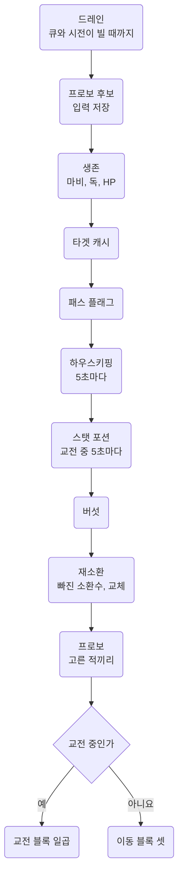
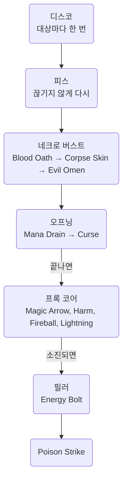
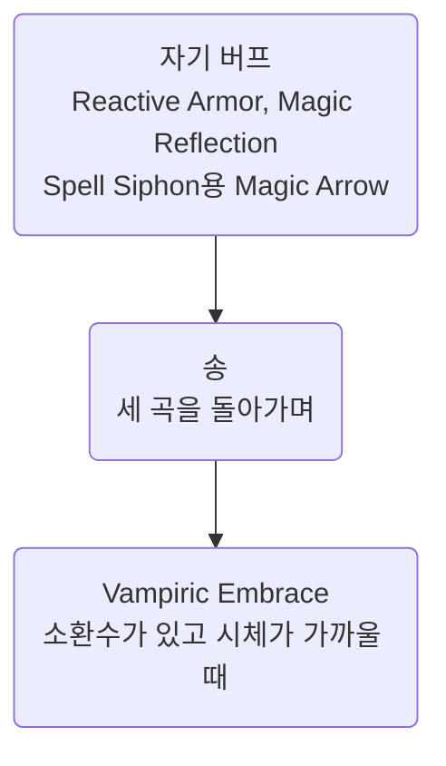

Bard Necro 템플릿의 사냥 루프 `bard-necro-enhanced`의 설계와 블록. 템플릿의 판단은 [Bard Necro](../templates/bard-necro.md).
인게임 확인은 [Bard Necro Checks](../verification/bard-necro.md#01) 01절.

대상 파일: **`script/combat/bard-necro-enhanced.razor`**. 2026-10-10부터 `recipe/bard-necro-enhanced-recipe.razor`와 모듈로 조립([Module Migration](../history/module-migration.md#01.D) 01.D절).

- 아래 블록 이름 = 결과물의 배너 제목. 그 블록의 모듈은 배너 오른쪽. PvP 루프는 [Bard Necro](../templates/bard-necro.md#04.F) 04.F절
- 구식 `bard-necro.razor`, `bard-necro-eval.razor`를 대체. 둘은 삭제, git 이력에만
- 기존 파일 수정이 아닌 **새로 작성.** 처음에는 `bard-throwing.razor`, `loadout.razor`의 모양, 지금은 모듈 형식([Modules](../scripting/modules.md)).
  변수 접두는 [Conventions](../scripting/conventions.md#03.A) 03.A절
- 바드 숫자와 공식은 모두 [Barding](../mechanics/barding.md). 여기서 다시 추론하지 않음
- **핫키 `bard-buff`는 이 템플릿에 불필요.** 루프가 이동 중 세 곡을 알아서 돌림. 다른 템플릿이 쓰므로 파일은 유지

## <a id="00"></a>00 한눈에

| 절 | 내용 |
| --- | --- |
| [01](#01) | 루프 한 장, 셋업, 자원, 마나 예산, 오프닝, 꼬이는 지점, 설계 결정, 명령문 비용 |
| [02](#02) | 소환수 식별, 이름과 재소환 상세의 위치 |
| [03](#03) | 틀렸던 생각 |

이 문서에 걸린 질문은 [Open items](../questions/open-items.md).

## <a id="01"></a>01 루프

### <a id="01.A"></a>01.A 루프 한 장

- 교전 여부는 레시피의 `# @ when var__fighting = 1` 그룹에서 한 번만 판정, 그 아래를 교전 블록과 이동 블록으로 나눔(01.H절).
  첫 그림의 "교전 중인가"가 그 자리
- 블록 하나는 한 패스에 **한 동작만**(`elseif` 사슬). 하지만 동작한 블록이 **패스를 끝내지는 않음**
- 시전이 끝나면 `casting`이 풀려 아래 블록도 같은 패스에서 차례를 받음 → 아래 그림은 우선순위일 뿐
- 블록 사이 순서가 필요한 곳은 플래그. 오프닝 → 프록은 `var__opener_done`, 프록 → Poison Strike와 필러는 `var__procs_done`

행동하는 블록은 모두 행동 창 가드. **가드를 빠뜨린 블록은 늘 이김.** 가드는 블록이 하는 일에 따라 결정.

| 블록 | 가드 |
| --- | --- |
| 주문 시전 | `not targetexists and not casting and cooldown "walk" = 0` |
| 아이템만 사용(포션, 무게, 악기 회수) | `not targetexists and not casting` |
| 읽기만(타겟 캐시, 패스 플래그) | 없음 |

- 걸으며 시전하면 걸음에 끊김, 포션은 걸으며 마셔도 됨 → `cooldown "walk"`는 시전 블록에만
- 예외: 긴급선(`emergency_hits`)의 Greater Heal은 걷는 중에도 시전. 달리는 동안 `walk` 바가 계속 돌아 기다리면 못 씀, 끊기면 다음 패스에 다시(2026-10-20 사용자 결정)
- 루프가 스스로 여는 시전과 커서는 `not warmode`도 확인. 공격 주문, 바드 스킬과 송, 자기 버프, Create Food, 소환, Corpse Skin, Evil Omen, Poison Strike, Vampiric Embrace
- warmode = 수동 모드 → 이 블록들 정지. 큐어, 힐, 포션, 버섯 먹기, Blood Oath는 계속
- 게이트 접기(01.H절) 이후 이 가드는 따로 한 줄을 쓰지 않고 각 블록 조건 줄 끝에 붙음

#### 한 패스



위 블록은 모든 패스가 통과, 교전 여부는 그 뒤에 한 번만. 교전 패스는 이동 블록을, 이동 패스는 교전 블록을 보지 않음.

| 블록 | 게이트 | 비고 |
| --- | --- | --- |
| 드레인 | `while queued or casting` | 이미 나간 동작이 끝난 뒤 상태를 읽음. 참조 스크립트 둘도 루프를 이렇게 시작. 이 루프는 `config__settle_first` 1. 시전을 봤으면 커서 응답까지 `wait__cast_cursor`(0.5초) 더 |
| 프로보 후보 입력 | `lastbeneficial` 변경 | `bard/provo-picks`. `V`의 가장 가까운 몹이나 `Shift+Space`로 등록. 교전과 바딩 쿨다운에 독립, 절차는 [Provocation Checks](../verification/provocation.md#01) 01절 |
| 생존 | `paralyzed or poisoned or diffhits > 0` | 세 상태를 한 줄로 묻고, 안에서 마비, 큐어, 힐 순서. 마비가 맨 앞: 마비 중에는 아래가 아무것도 못 함. 큐어가 힐보다 앞: 큐어는 즉시 끝나고 힐은 독 틱에 일부 손실 |
| 타겟 캐시 | `lastharmful`과 `noto`, 화면 거리 | 18칸(`config__acquire_range`) 안에서 받아 두고 10칸(`config__target_range`) 안에서 교전. 블록은 사본(`var__combat_target`)에 걺. 블록이 자기 용도로 찍은 몹은 `var__target_hold`로 빼 둠 |
| 패스 플래그 | `timer "timer__reagents"` 10초, 또는 시약 부족 문장 | 시약과 주문 플래그 생성(`magery/reagents`, 아래). 심볼 수를 읽는 `ingump` 사슬은 게이트 없이 매 패스(01.H절). 심볼을 못 읽으면 `necro/symbols`가 30초에 한 번 핫바 재오픈 |
| 하우스키핑 | `# @ every interval__housekeeping` 5초 | 악기 회수, 리프레시 포션, 소환수 이름, 골드는 틱마다. 악기 확인(30초), 음식(60초)은 자기 시계. 디스코 건 대상은 `bard/disco`가 교전 패스마다 30초 뒤 잊음(01.H절) |
| 스탯 포션 | 교전 중 `timer__potion_check` 5초. 마신 다음 패스는 바로 | 하우스키핑 밖. 이유는 01.H절 표 |
| 재소환 | `followers < config__summon_followers` 또는 교체 시계 | 교전 중에도 빠진 소환수를 바로 채움. 교체는 기억한 적이 없을 때만. 설계는 [Bard Necro Summons](bard-necro-summons.md#03) 03절 |
| 프로보 | 짝 찾기는 교전 중, 쿨다운 칸과 Music이 빌 때 2초마다, 할 일이 없으면 5초마다 | 등록 후보 목록에서 선택(`bard/provo`). 입력은 별도 블록, 비용은 01.H절 |
| 교전 중인가 | `var__fighting = 1`(레시피 그룹) | 한 번만 판정. 그 아래 블록은 재판정 안 함 |

- **`magery/reagents`의 시약 플래그는 10초에 한 번**(`timer__reagents`)
- 시약 여덟 종을 `findtype`으로 한 번씩 찾아 `var__has_*`에 저장, 주문 플래그 18개는 그 여덟의 비교로 생성
- 매 패스 `findtype` 19\~32번에서 이렇게 감소(01.H절)

#### 교전 블록



화살표는 같은 패스 안의 다음 차례. 라벨 붙은 화살표는 플래그 → 앞 블록이 끝나야 뒤 블록 시작
(`var__opener_done`, `var__procs_done`).

| 블록 | 게이트 | 비고 |
| --- | --- | --- |
| 디스코 | `cooldown "disco" = 0 and cooldown "music" = 0` | 대상마다 한 번. 걸린 대상은 30초 동안 재확인 안 함(`interval__disco_seen`) |
| 피스 | `cooldown "peace/provo" = 0 and cooldown "music" = 0` | **계속 재시전.** 이 Musicianship에서 지속 12초, 슬롯 쿨 10초. 진정과 브레이크 라벨은 2초에 한 번 확인(`interval__peace_seen`) |
| 네크로 버스트 | `list 'list__necro_symbols' >= config__symbols_*` | Blood Oath, Corpse Skin, Evil Omen 순서. Blood Oath는 소환수가 있을 때만, Corpse Skin과 Evil Omen은 서 있고 warmode가 아닐 때만. 심볼 몫은 [Necromancy](../mechanics/necromancy.md#02) 02절. 재소환이 심볼을 모으는 동안 정지(`var__hold_symbols`, [Bard Necro Summons](bard-necro-summons.md#03) 03절) |
| 오프닝 | 마나와 대상별 리스트 | Mana Drain 다음 Curse. Curse 시약이 없으면 라이더 없이 진행(01.E절) |
| 프록 코어 | `cooldown "magic arrow"` 같은 바와 `var__opener_done` | 네 개가 각자 쿨. 시전마다 대상을 `var__proc_target`에 기록 |
| 필러 | `var__procs_done`과 `mana > config__filler_floor` | Energy Bolt. 프록이 모두 쿨인 동안만. **마나는 여기부터 잘림** |
| Poison Strike | `var__procs_done`과 `var__proc_target` | 심볼 1개. 재소환이 심볼을 모으는 동안 정지. 맨 끝이라 같은 패스의 Energy Bolt 질병까지 터뜨림. 마지막 프록이 이 대상일 때만. 네크로 능력이 나간 패스는 건너뜀(`var__symbols_spent`). Corpse Skin 조건은 [Necromancy](../mechanics/necromancy.md#02) 02절 |

#### 이동 블록



- 몹이 없는 동안만. 쿨과 버프를 걷는 사이에 채워 다음 교전에서 로테이션과 경쟁하지 않게
- 버섯(`buff/mushroom`)은 2026-10-10부터 분기 앞. 먹기는 아이템 사용 → 교전 중에도 마나 55 이하면 사용
- Create Food는 시전 → 이동 중에만, 60초 쿨이 걷는 동안 진행

| 블록 | 게이트 | 비고 |
| --- | --- | --- |
| 자기 버프 | `not findbuff`와 `cooldown "reflect"` | 둘 다 시간이 아닌 소모로 끝남. RA는 25 흡수. Reflect의 PvP 재시전 제한은 [PvP Magery](../game/pvp-magery.md#04.A) 04.A절, 기존 30초 설명을 PvP 플래그 중에 그대로 쓰지 않음. 마지막 갈래는 Spell Siphon을 켜는 자기 대상 Magic Arrow(`use_spell_siphon` 1). 튕겨서 리플렉트를 태우지 않게 Magic Reflection이 없을 때만 |
| 송 | `cooldown "song" = 0 and cooldown "music" = 0`과 그 곡의 슬롯 | 라운드로빈(01.G절) |
| Vampiric Embrace | `followers > 0`, 심볼 9, 8칸 안의 시체 | 시체 없음 문장이 뜨면 5초 대기(`interval__embrace_miss`). 재소환이 심볼을 모으는 동안 정지 |

#### 데미지 사이클

프록 네 개는 각자 쿨, **빈 시간은 모두 Energy Bolt.**

| 초 | 무엇 | 서클 | 시전 + 회복 | 비고 |
| --- | --- | --- | --- | --- |
| 0.0 | Magic Arrow | 1서클 | 0.50 + 0.2 |   |
| 0.7 | Harm | 2서클 | 0.75 + 0.2 |   |
| 1.7 | Fireball | 3서클 | 1.00 + 0.2 |   |
| 2.9 | Lightning | 4서클 | 1.25 + 0.2 |   |
| 4.3 | **프록 네 개를 다 쓰고 쿨 대기** |   |   |   |
| 4.3 | Energy Bolt | 6서클 | 1.75 + 0.2 | 20마나. 5초 안에 죽이면 실제 비용 5 |
| 6.3 | Poison Strike | 심볼 1 | 시전 없음 | 질병 5개(프록 4 + 볼트 1). Corpse Skin이 켜져 있고 자기 쿨 30초가 돌았을 때 |
| 6.3 | Energy Bolt | 6서클 | 1.75 + 0.2 |   |
| 8.2 | Energy Bolt | 6서클 | 1.75 + 0.2 |   |
| 10.2 | Energy Bolt | 6서클 | 1.75 + 0.2 |   |
| 12.1 | Energy Bolt | 6서클 | 1.75 + 0.2 |   |
| 14.1 | **프록이 돌아오면 다시 위로** |   |   |   |

- **15초당 시전 4회 → 9회.** 이 순서는 자동으로 지켜지지 않음
- 시전이 패스를 끝내지 않음 → Poison Strike와 필러는 `PROC CORE` 바로 뒤에서 계산하는 `var__procs_done`을 확인
- 이 플래그는 네 프록이 각자 바에 올라 있거나 시약이 없을 때만 1. 마나 부족은 미포함
- 마나는 돌아오고 그동안 소환수가 싸움 → Poison Strike도 프록을 기다림. 필러는 바닥(52)이 어차피 모든 프록 비용보다 높음
- 바 하나가 돌아오면 다음 시전은 프록 코어 차지. 볼트 도중 돌아온 바는 남은 시전 시간(최대 1.95초)만큼 대기
- 이 플래그가 없을 때는 Curse와 첫 프록 바로 뒤에 Poison Strike와 Energy Bolt가 같은 패스에서 나감. 2026-09-28 수정
- Poison Strike는 패스 맨 끝, 필러 다음. 프록을 다 쓴 패스에 마나가 있으면 볼트 먼저 → 질병 하나 더 붙은 뒤 터뜨림
- 마나가 필러 바닥 아래면 볼트가 안 나감 → 기다리지 않고 프록 네 개분을 터뜨림. 자기 쿨 30초 → 프록 사이클(15초) 두 번에 한 번
- 볼트는 대상을 찍고 0.5초 뒤 적중([Magery](../mechanics/magery.md#02.D) 02.D절) → Poison Strike 전에 `wait__short`(0.2초) 추가 대기.
  볼트 뒤 `wait__cast` 0.3초와 합쳐 0.5초
- 빠른 연결에서 Poison Strike가 볼트 질병보다 먼저 들어가지 않게. 30초에 한 번이라 비용은 거의 없음
- Poison Strike는 `var__proc_target`도 확인. 프록마다 대상을 기록, 마지막 프록의 대상이 지금 대상일 때만
- 이전 몹의 프록 쿨이 남은 채 새 몹 오프닝이 끝나면 `var__procs_done`은 이미 1이지만 그 몹에는 프록 질병이 없음.
  그동안 Energy Bolt는 그대로. 필러는 대상을 가리지 않음

**마나가 모자라면 필러부터 잘림.** 바닥 `config__filler_floor` 52의 근거는 01.D절.

### <a id="01.B"></a>01.B 셋업에서 한 번만 하는 것

| 무엇 | 방법 |
| --- | --- |
| 악기 | 캐시, 자동 탐색, 수동 선택 순서. 없으면 `stop` |
| 크룩 활성화 | 레시피에 `tamer/herding` 없음. Herding이 템플릿에서 빠져(Resisting Spells 80) 크룩은 무동작. 다시 찍으면 레시피에 추가 |
| 네크로 핫바 | 루프 안의 `UNHOLY SYMBOLS`(`necro/symbols`)가 심볼 수를 못 읽은 첫 패스에 오픈. 타이머가 만료 상태로 시작 |
| 시계 | 하우스키핑, 핫바, 음식, 스탯 포션, 악기 확인, 피스 확인, 시약 리프레시 시계를 만료 상태로 → 첫 패스가 모두 확인 |
| 소환수 이름 | 시작마다 `list__summon_kinds` 재작성, 이미 이름 붙인 serial을 담은 `list__named_summons`는 비움(`necro/summon-names` setup) |
| 재소환 | VS와 Wither 시계는 만료 상태 → 첫 패스부터 누를 수 있음. 교체 시계 둘은 0 → 첫 교체는 Play 뒤 10분(`necro/resummon`, [Bard Necro Summons](bard-necro-summons.md#03) 03절) |

### <a id="01.C"></a>01.C 자원

| 자원 | 쓰는 곳 | 성격 |
| --- | --- | --- |
| `cooldown "music"` | 바드 **스킬** 사용 | 글로벌 5초. **송은 이것을 안 세움** |
| `cooldown "disco"` | Disco | 혼자 쓰는 슬롯 5초 |
| `cooldown "peace/provo"` | Peace와 Provo | **공유 슬롯 10초.** 합친 항목 하나 |
| `cooldown "song"` | 세 곡 전체 | **별도 계열. `cooldown "music"`이 아님.** 세 곡 공유 |
| Unholy Symbol | Blood Oath (4), Corpse Skin (2), Evil Omen (2), Poison Strike (1), Vampiric Embrace (3), Vengeful Spirit (1), Wither (5) | 5초에 1개, 최대 Effective Necro / 10 = **10** |
| 마나 | 버프, 오프닝, 프록 코어, 필러, 소환(50) | 메디가 없어 가장 빡빡함 |

**자원은 따로지만 행동 슬롯은 하나.** 교전 블록 하나의 모양(프록 코어의 Harm).

```
if cooldown "harm" = 0 and var__regs_harm = 1 and mana >= config__mana_2nd and var__opener_done = 1 and not warmode and not targetexists and not casting and cooldown "walk" = 0
    if find var__combat_target ground -1 -1 config__target_range as alias__proc_target
        cast 'Harm'
```

조건 줄 끝의 행동 창이 행동 슬롯을 지킴. 대상 `find`는 쏘는 갈래 안에서만(01.H절 게이트 접기).

#### 루프 규칙 하나

**송은 교전 중 금지. 이동 블록에서만**(01.A절). 이유는 [Barding](../mechanics/barding.md#01.E) 01.E절.
교전 중에는 디스코와 피스가 `music`을 계속 세우고, 악기 연주가 시전을 끊음.

#### `cooldowns.xml`은 정리 완료

- `config/indian/classicuo/nomeehej/cooldowns.xml`의 내역과 이유는 [Barding](../mechanics/barding.md#01.I) 01.I절, 쿨 모델은 [Barding](../mechanics/barding.md#01.E) 01.E절
- 바드 쿨 판단은 [Barding](../mechanics/barding.md#01.D) 01.D절, Lyric 리셋 대응은 [01.G절](../mechanics/barding.md#01.G)

| 행동 | 게이트 |
| --- | --- |
| Disco 송 | `cooldown "music" = 0 and cooldown "song" = 0 and cooldown "disco" = 0` |
| Peace 송, Provo 송 | `cooldown "music" = 0 and cooldown "song" = 0 and cooldown "peace/provo" = 0` |
| Disco 스킬 | `cooldown "music" = 0 and cooldown "disco" = 0` |
| Peace 스킬 | `cooldown "music" = 0 and cooldown "peace/provo" = 0` |
| 프록 주문 | `cooldown "magic arrow"`, `"harm"`, `"fireball"`, `"lightning"`이 `= 0` |
| 필러 | 프록 넷이 모두 쿨(`var__procs_done = 1`), `mana > config__filler_floor` |

바드 외 스킬을 루프에 넣으면 `music` 대신 `skill`([Barding](../mechanics/barding.md#01.J) 01.J절).

### <a id="01.D"></a>01.D 마나 예산

| 주문 | 서클 | 마나 |
| --- | --- | --- |
| Magic Arrow | 1 | 4 |
| Harm | 2 | 6 |
| Fireball | 3 | 9 |
| Lightning | 4 | 11 |
| Curse | 4 | 11 |
| Mana Drain | 4 | 11 |
| **Energy Bolt** | 6 | 20. T3는 **볼트 뒤 5초 안에 대상이 죽을 때만** 15 회수 |
| Create Food | 1 | 4 |

**15초 창을 시전 시간으로 정확히 나눔.** 시전 시간 + 회복 0.2초.

| 주문 | 서클 | 시전 + 회복 | 초 |
| --- | --- | --- | --- |
| Magic Arrow | 1서클 | 0.50 + 0.2 | 0.70 |
| Harm | 2서클 | 0.75 + 0.2 | 0.95 |
| Fireball | 3서클 | 1.00 + 0.2 | 1.20 |
| Lightning | 4서클 | 1.25 + 0.2 | 1.45 |
| **프록 코어 합** |   |   | **4.30초** |
| Energy Bolt | 6서클 | 1.75 + 0.2 | 1.95 |

- `15 - 4.30 = 10.70`초가 비어 있었음. Energy Bolt를 넣으면 `10.70 / 1.95 = 5.4` → 필러 5방
- **15초당 시전 4회 → 9회, 2.25배.** `Bless`를 버리고 `Energy Bolt`를 넣은 근거

| 15초 창 | 식 | 마나 |
| --- | --- | --- |
| 오프닝(몹 1마리당) | Mana Drain 11 + Curse 11 | 22 |
| 프록 코어(15초) | 4 + 6 + 9 + 11 | 30 |
| 필러(15초) | Energy Bolt x5, 한 방에 20. 마무리면 5 | 100 (\~25) |
| **15초당** |   | **152 (\~77)** |

| 1분 교전 | 식 | 실질 마나 |
| --- | --- | --- |
| 코어와 오프닝 | 코어 120 + 오프닝 22 = 142, 환급 56% 적용 | 62 |
| 필러 | 20방 x 20, 환급 56% 적용. 마무리면 x 5 | 176 (\~100) |
| **합** |   | **실질 약 238/분 = 4.0 마나/초**. 모두 마무리면 2.7 |

- 괄호 안 값은 모두 마무리인 경우. `Energy Bolt`의 15마나는 **볼트 뒤 5초 안에 대상이 죽을 때만**(Grimoire 원문, [Magery](../mechanics/magery.md#01) 01절)
- 잡몹 마무리 때만 실제 비용 5, 체력 큰 몹은 20 그대로
- 환급 56% = Eldritch 26%([Bard Necro](../templates/bard-necro.md#01.A) 01.A절) + Mana Drain 라이더 30%(01.E절)
- **이동 10\~20초에는 마나 미사용.** Avarhide double mana regen 60%와 `Create Food` 버섯 분당 25 추가
- 그래도 **메디 없이 초당 2.7\~4.0은 버거움**

확인되지 않은 것 둘.

1. Eldritch 환급과 Grimoire 환급의 합산 여부. 따로 굴리면 실효 `48%`
2. `Energy Bolt` 15마나 회수(5초 안에 죽을 때만)와 환급 확률의 중첩 여부. 위 표는 비중첩 가정, 마무리 볼트에 환급 미적용

- **프록 쿨은 더 이상 마나 조절기가 아님.** 빈 10.7초가 사라져 마나가 실제 상한
- **필러 5방은 이론값, 실제로는 마나가 허락하는 만큼**

| 주문 | 시점 |
| --- | --- |
| 프록 4종 | 마나가 남는 한 항상. 창마다 30마나 |
| Energy Bolt | `mana > config__filler_floor`일 때만. **여기서 먼저 잘림** |

`config__filler_floor`는 오프닝 22 + 프록 코어 30 = **52 이상**(지금 52). 필러가 마나를 다 먹어 다음 몹 오프닝을 못 거는 일 방지.

### <a id="01.E"></a>01.E 오프닝은 대상마다 재시전

> Curse T3: "Spells cast by caster **against target** have their damage increased by 30%"
> Mana Drain T3: "Increases mana refund chance by 30% for caster's hostile spells **cast against target**"

**둘 다 대상 디버프.** 몹을 바꾸면 안 따라옴. Discordance와 Peace도 같음.

#### 지속시간 불일치

|  | 지속 | 효과 |
| --- | --- | --- |
| 베이스 디버프 | 2분 | Curse -5%, Mana Drain -20 Magic Resist |
| Grimoire 라이더 | 60초 | 데미지 +30%, 환급 +30% |

**디버프 아이콘이 남아도 +30% 두 개는 이미 꺼짐** → `getlabel`로 판정 불가.

#### 리스트 두 개로 상태 표현

| 상태 | 뜻 |
| --- | --- |
| `list 'list__magic_drained_targets'` | Mana Drain을 마친 serial |
| `list 'list__magic_cursed_targets'` | Curse를 마친 serial |
| `timer__magic_window` | 마지막 Curse 이후 경과 시간. `interval__magic_window`(60000)가 지나면 두 리스트 비움 |

```
if timer "timer__magic_window" >= interval__magic_window
    clearlist 'list__magic_drained_targets'
    clearlist 'list__magic_cursed_targets'
    settimer "timer__magic_window" 0
endif
```

| 대상 | 다음 시전 |
| --- | --- |
| drained에 없음 | Mana Drain |
| drained에 있고 cursed에 없음 | Curse. 들어가면 `settimer` 0 |
| cursed에 있음 | 프록 코어 |

- 타이머는 **Curse가 들어갈 때마다 0.** 한 마리 전투는 만료가 정확히 60초, 두 마리면 먼저 건 쪽이 몇 초 일찍 지워짐. 주기적 삭제보다 나음
- 분기 자체가 상태 → `var__magic_stage` 같은 단계 변수 불필요
- **두 리스트는 구식 `bard-necro.razor`에서 가져옴.** 그 파일은 삭제(git 이력),
  같은 두 리스트가 `bard-necro-enhanced.razor`의 `magery/rotation` 모듈 `OPENER`에 그대로 있음
- **맞바꾼 것**: 비우기가 전역이라 방금 건 대상까지 삭제. 동시에 1\~2마리와 싸우면 가끔 22마나 손해.
  **대상마다 타임스탬프는 산술이 필요해 불가**
- **막힘 방지**: 타이머가 아닌 **조건**으로 해결. Curse 시약이 없으면 `var__opener_done`이 그냥 1 → 프록과 필러가 라이더 없이 진행
- 시약은 다음 보급까지 안 돌아옴. 살아 있는 몹 앞에서 스크립트가 서 있는 것보다 30% 덜 아프게 때리는 쪽이 나음
- **마나 부족은 여기 미포함.** 마나는 돌아오고 그동안 소환수가 싸움.
  라이더 없는 주문에 쓴 마나만큼 다음 오프닝이 늦어짐 → 22가 찰 때까지 기다렸다가 라이더를 달고 공격

```
if inlist 'list__magic_cursed_targets' var__combat_target
    @setvar! var__opener_done 1
elseif var__regs_curse = 0
    @setvar! var__opener_done 1
else
    @setvar! var__opener_done 0
endif
```

#### 구식 스크립트의 버그, 반복 금지

- **두 구식 스크립트의 같은 버그**(둘 다 삭제, git 이력). `clearlist`가 **전투 대상이 사라지고 조용해졌을 때만** 실행
- 한 마리와 60초 넘게 싸우면 Curse의 `+30%`가 꺼졌는데도 리스트는 "걸려 있음" → **영영 재시전 안 함**
- 난이도 300\~500 몹은 대부분 해당. **만료는 교전 종료가 아닌 시간으로 측정**

### <a id="01.F"></a>01.F 꼬이는 지점

| 조합 | 꼬이나 | 이유 |
| --- | --- | --- |
| 디스코 x Curse x Mana Drain | 안 꼬임 | 효과가 모두 다르고 중첩 |
| 디스코 x Barding Break | 안 꼬임 | **디스코는 브레이크로 안 끊김** |
| **Peace x Barding Break** | **꼬임** | 끊기면 `Ensemble` 조건도 함께 꺼짐. `Refrain`이 방지 |
| 피스 x 공격 | 안 꼬임 | **피스는 데미지로 안 풀림.** 걸고 때려도 됨 |
| **Song x Song** | **꼬임** | **세 곡이 쿨 하나를 공유.** 이어 부르면 곡마다 11초 |
| **Skill → Song** | **꼬임** | 스킬이 `music` 5초를 세워 송을 밀어냄. 송이 급하면 스킬을 참음 |
| Song → Skill | 안 꼬임 | 송은 `music`도 스킬 슬롯도 안 세움. 1.5초 뒤 디스코 가능 |
| `clearsysmsg` x `insysmsg` | 위험 | 루프 안에서는 안 지움. `clearsysmsg`는 셋업에만(`config__clear_at_start` 1일 때), 판정은 시전한 블록 안에서 끝냄 |
| 송 x 시전 | **꼬임** | 악기 연주가 시전을 끊음. `not casting` 필수. 그래서 교전 중에는 안 부름 |
| **Peace 스킬 x Peace 송, Provo 송** | **꼬임** | 슬롯 공유. 교전 직후 10초 동안 두 곡 막힘 |
| Peace x Provo | **꼬임** | 서버가 슬롯 공유. 둘 다 쓰려면 10초씩 교대 |

### <a id="01.G"></a>01.G 설계 결정

**송은 재소환을 감지하지 않음. 이동 중 송을 계속 갱신.** 재소환 자체는 `necro/resummon`([Bard Necro Summons](bard-necro-summons.md#03) 03절).

- 송 쿨은 약 11초뿐, 전투 사이클마다 10\~20초 이동 → 이동마다 라운드로빈으로 한 곡씩이면 **세 곡이 늘 새것**
- 소환수를 언제 다시 뽑든 다음 이동 구간에서 버프 적용

이 결정 하나로 사라진 것.

| 없앤 것 | 이유 |
| --- | --- |
| `list 'sung_followers'` serial 명부 | 추적 불필요 |
| `findtype` 소환수 훑기와 `noto` 필터(송용) | 적 Lich를 내 것으로 오인하는 문제 해결. 같은 모양이 나중에 이름 붙이기용으로만 복귀([Bard Necro Summons](bard-necro-summons.md#02) 02절) |
| `var__resing` 플래그와 우선순위 예외 | 송을 늘 갱신 → 급한 재시전 없음 |
| 교전 중 세 곡 몰아 부르기(약 22초) | 교전 중에는 아예 안 부름 |

- **대가**: 소환수가 교전 중 죽고 다시 뽑히면 **그 교전이 끝날 때까지 송 버프 없음**
- 세 곡 각 8.5% → 한 판 일부 구간에서 그만큼 손해. 위 복잡함을 모두 없애는 값으로는 쌈
- **라운드로빈은 산술 없이 리터럴 상태값.** `var__song_next`가 1, 2, 3을 순환, 곡마다 자기 슬롯도 확인
- 교전이 막 끝나면 Peace 슬롯이 10초 남아 Peace 송과 Provo 송 둘 다 막힘 → 그 패스를 건너뛰고 다음 패스에 재시도

코드는 `module/bard/song.razor`의 BARD SONG.

- `var__song_next`는 노래가 들어간 뒤에만 진행(`under the effect of a Song`). 막히거나 실패한 곡은 건너뛰지 않고 6초 뒤 재시도
- 스킬이 없는 곡(`skill "..." = 0`)에서는 라운드로빈 정지 → 바딩 세 스킬 모두 필요
- 백팩을 찍어 적대 칸(`lastharmful`)이 백팩으로 바뀌어도 루프는 사본을 써서 영향 없음 → 고른 대상을 지키는 재확인이 필요 없음([Barding](../mechanics/barding.md#01.B) 01.B절)
- `findbuff "song of ..."`로 게이트하지 않음. 15분 버프라 늘 참 → 갱신이 영영 안 돎. **`cooldown "song" = 0`을 보고 다음 곡**
- 이동 구간이 10\~20초라 슬롯은 대개 그 안에 풀림. 못 부른 곡은 다음 이동에서
- **재소환해도 Bless는 재시전 안 함.** 애초에 Grimoire에서 제외

### <a id="01.H"></a>01.H 명령문 비용 적용

측정값과 원칙은 [Razor](../scripting/razor.md#06) 06절. 원칙: 자주 안 바뀌는 상태는 타이머로 게이트, 흔한 경로가 밟는 줄 감소. 이 루프의 적용:

- **시약 플래그.** 예전 PASS FLAGS는 시약 플래그 13개를 **매 패스** `findtype` 19\~32번으로 재확인, 패스마다 0.4 \~ 1.3초
  - 지금은 `magery/reagents`가 `interval__reagents`(10초. 2026-10-10 전에는 30초)마다 시약 여덟 종을 한 번씩만 찾아 `var__has_*`에 저장.
    여덟째 Bloodmoss는 2026-10-18 소환용으로 추가
  - 주문 플래그 18개는 그 여덟을 `=`로 비교해 생성 → 리프레시 한 번에 `findtype` 8번, 그 사이 패스는 타이머 비교 한 줄
  - 시작 시 타이머 만료 → 첫 패스는 반드시 확인
  - 묵은 플래그의 대가는 시전 한 번의 거부. 거부 문장 `More reagents are needed for this spell.`(인게임 확인됨 2026-09-28)이 보이면 창을 기다리지 않고 다음 패스에 재확인
  - 이 처리가 없던 때는 창이 끝날 때까지 같은 주문을 패스마다 재시도. 시약은 대상을 찍을 때 검사 → 시도마다 시전 시간을 다 쓰고 실패([Magery](../mechanics/magery.md#02) 02절)
  - 공통 PvP 자기관리도 시약 캐시 사용. 읽는 시약과 주기는 [PvP Loop](pvp.md)
- **소환수 이름.** `necro/summon-names` 블록은 하우스키핑 틱(5초)마다 한 번
  - 매치를 훑는 `findtype`은 매치 수보다 한 번 더 호출, 아직 이름이 없는 내 소환수마다 `getlabel` 하나
  - 2026-10-18 Rag Witch 바디 740 확인으로 기본 이름 `a rag witch` 재검색 삭제([Bard Necro Summons](bard-necro-summons.md#01) 01절)
- **재소환.** `necro/resummon`은 분기 앞, 둘 다 나와 있고 교체할 때가 아니면 게이트 한 줄
  - 기억한 적이 있으면 교체 시계가 넘어도 두 번째 줄에서 멈춤. 교체는 적이 없을 때만
  - 첫째 종류를 찾는 `findtype`은 시전 직전 한 번, 두 종류가 다를 때만
- **교전과 이동 분기**(2026-09-29, 2026-10-10부터 레시피 그룹). 모든 패스가 지나는 블록(생존, 타겟 캐시, 시약, 심볼, 하우스키핑) 뒤에서,
  `# @ when var__fighting = 1` 그룹이 교전 여부를 한 번만 판정
  - 교전 쪽: 디스코, 피스, 네크로 버스트, 오프닝, 프록 코어, 필러, Poison Strike. 이동 쪽(`# @ otherwise`): 자기 버프, Spell Siphon, 송, Vampiric Embrace
  - 스탯 포션, 버섯, 재소환, 프로보는 분기 앞. 후보 입력은 패스 첫머리의 별도 블록. 스탯 포션은 `var__fighting`을 직접 읽음
  - 이전에는 블록마다 교전 여부를 따로 확인 → 이동 패스도 디스코와 피스의 실패하는 `find`까지 밟음
- **하우스키핑 틱**(2026-09-29 적용). 매 패스 볼 필요 없는 확인을 5초 `# @ every interval__housekeeping` 그룹 하나에 모음
  - 패스는 그 게이트 한 줄만. 더 긴 주기는 안에서 자기 시계를 한 번 더 확인
  - 시작 시 시계를 모두 만료 → 첫 패스는 다 확인. 시계는 조건 맨 앞 → 대부분 패스에서 뒤의 검색 생략

| 무엇 | 주기 | 이유 |
| --- | --- | --- |
| 악기 회수, 무게, 리프레시 포션, 소환수 이름 | 틱마다(5초) | 줍기와 전투로만 바뀜. 이름은 전에 3초 창 |
| 악기(`find var__my_instrument`) | 30초 | 부서지거나 도둑맞을 때만 사라짐. 바드 블록이 없어진 것을 보면 그 자리에서 즉시 내림 |
| 핫바(`gumpexists`) | 30초 | 죽음, 재접속, 잘못 누름일 때만 닫힘. 닫힌 동안 네크로 능력 정지. 이 확인은 하우스키핑이 아닌 `necro/symbols`가 심볼을 못 읽었을 때 |
| 음식 버프 | 60초 | 버프가 훨씬 오래 감 |
| 스탯 포션 버프 | 5초(교전 중에만), 마신 다음 패스는 바로 | 버프가 몇 분 지속. 2026-10-23부터 하우스키핑 밖 자기 시계. 틱 안에서는 행동 큐가 한 틱에 한 병만 보내 셋에 10초. 힘과 민첩은 Bless와 아이콘이 같아 STR과 DEX를 기준선과 비교, 재시도 간격도 5초([Combat](../mechanics/combat.md#02.D) 02.D절) |
| 디스코 확인(`var__disco_seen`) | 30초 | Discordance 지속 1분 21초 \~ 1분 57초([Bard Necro](../templates/bard-necro.md#01.D) 01.D절). 한 번 확인한 대상은 30초 동안 `find`와 `getlabel` 생략 |
| 피스 확인(`timer__peace_seen`) | 2초, 게이트에서 | 진정 12초와 슬롯 10초의 차이. 브레이크 40초 동안은 매 패스 대신 2초에 한 번 |

- **생존 게이트**(2026-09-29 적용). 마비, 독, HP 세 블록을 한 줄 게이트 뒤에 모음. 멀쩡한 패스는 세 줄 대신 한 줄
  - 당시 게이트는 `if paralyzed or poisoned or diffhits > config__light_hits`
  - 2026-10-10부터 모든 레시피가 회복 블록을 `# @ when paralyzed or poisoned or diffhits > 0`으로 묶음([Modules](../scripting/modules.md#03) 03절)
- **게이트 접기**(2026-09-29 적용). 늘 참인 바깥 `if`(수동 모드, 행동 창, 스킬과 악기 준비)를 안쪽 조건 한 줄에 합침. 할 일 없는 블록은 패스마다 한 줄
  - 대상 `find`는 실제로 쏘는 갈래 안으로 이동 → 오프닝과 프록 코어는 주문이 나갈 때만 대상 검색
  - 매 패스 세우던 플래그 둘(`var__bard_ready`, `var__manual`) 제거, 게이트가 `warmode`와 악기 상태를 직접 읽음
  - 드레인 둘은 `while queued or casting` 하나로, 시약 부족 문장은 리프레시 게이트의 `or`로 통합
- **패스당 비용.** 측정값은 [Razor](../scripting/razor.md#06) 06절. 줄 하나 5 \~ 10ms, 거짓 `if` 10 \~ 20ms, `find` 20 \~ 40ms
  - 줄 = 패스가 실제로 밟는 명령문. 참이었던 `if`의 `endif`도 한 줄

| 경우 | 게이트 접기 전 | 게이트 접기 뒤 |
| --- | --- | --- |
| 교전 중, 이번 패스에 할 일 없음 | 약 75줄, `find` 4 → 0.6 \~ 1.2초 | 약 37줄, `find` 2 → 0.3 \~ 0.65초 |
| 걷는 중, 대상 없음 | 약 41줄, `find` 1 → 0.35 \~ 0.65초 | 약 19줄, `find` 1 → 0.2 \~ 0.35초 |

- 5초마다 하우스키핑 틱이 0.4 \~ 0.8초 추가. 소환수가 있을 때, 대부분 이름 검사
- 10초마다 시약 리프레시가 0.5 \~ 1초 추가. 시전 있는 패스는 여기에 시전 시간
- Peace 슬롯이 열렸는데 대상이 진정이나 브레이크 중이면, 전에는 `find`와 `getlabel`이 든 7줄이 매 패스 추가. 지금은 2초에 한 번
- 입력이 안 바뀐 패스의 검색은 타겟 캐시의 `find lastharmful`과 `find var__combat_target`(대상이 있을 때만) 둘. 후보 입력은 값이 바뀔 때만 `find`, 등록에 `getlabel` 없음
- 프로보 한 판은 목록의 몹마다 `find` 한두 번, 짝 후보마다 `getlabel` 하나. 짝을 만드는 동안 2초, 할 일이 없으면 5초 간격. 목록은 누가 빠지거나 실패 후보를 뒤로 보낼 때 재작성. 새 후보는 바로 다시 봄
  - 버섯의 `findtype`은 마나가 낮을 때만, `counttype`은 이동 중 서 있을 때만 조건 끝에서 읽힘
- **심볼 수 읽기.** 네크로 핫바 gump는 심볼을 `"<have>/<max>"`로 표시, 루프는 그 글자를 `ingump`로 읽음
  - `ingump`는 부분 문자열 매칭 → 큰 수부터 내려오는 사슬(`10/`부터 `1/`까지). Necromancy 100이면 최대 10
  - 핫바가 11 이상을 보이면 위에 줄 추가. `"11/11"`이 `"1/"`로 읽힘. 핫바가 닫히면 0으로 읽혀 능력 모두 정지
  - 게이트는 `list 'list__necro_symbols' >= config__symbols_*`로 비교. 변수끼리는 크기 비교 불가([Razor](../scripting/razor.md#03) 03절)
  - 각 갈래 안에서 **읽은 값이 `var__symbols_listed`와 다를 때만** 리스트 재작성. 패스마다 사슬과 안쪽 `if` 두 줄. 인게임 확인됨 2026-09-28
  - 채우기는 갈래별 리터럴 `for N`. `for` 횟수에 변수 불가(`Invalid for loop syntax`), `while not list … >= var`는 파싱 안 됨
  - 둘 다 2026-09-28 확인. 읽기 사슬은 20갈래에서 10갈래로 감소

## <a id="02"></a>02 소환수 블록 상세

소환수 블록의 설계와 실패 증상은 [Bard Necro Summons](bard-necro-summons.md).

### <a id="02.A"></a>02.A 식별과 바디 번호

종류별 바디 번호와 소유 필터는 [Bard Necro Summons](bard-necro-summons.md#01) 01절.

### <a id="02.B"></a>02.B 소환수 이름

이름 표와 SUMMON NAMES의 검색 규칙은 [Bard Necro Summons](bard-necro-summons.md#02) 02절.

### <a id="02.C"></a>02.C 재소환과 교체

Vengeful Spirit 창, 마나와 심볼, 교체 조건은 [Bard Necro Summons](bard-necro-summons.md#03) 03절.

::part[기록]

## <a id="03"></a>03 자주 틀렸던 것

| 틀린 생각 | 사실 |
| --- | --- |
| 네크로 능력 Razor 핫키는 이 빌드에서 안 먹음 | **먹음.** 능력이 안 나가던 원인은 심볼 수를 읽는 `ingump` 비교 오류. Vengeful Spirit 핫키가 안 나간 것은 macOS에서 게임에 안 들어오는 `` Alt+` ``에 걸었기 때문([Hotkeys](../game/hotkeys.md#02.B) 02.B절) |
