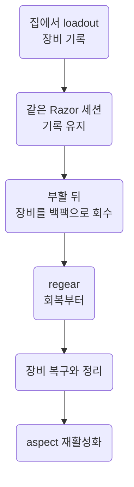

`restock/loadout`과 `hotkey/regear`의 준비, 실행 순서와 설정. 두 스크립트는 한 번 돌고 끝나는 조립 루틴.
조립 규칙은 [Modules](../scripting/modules.md#03.A) 03.A절, 실제 관찰과 통과 기준은 [Loadout Checks](../verification/loadout.md).

## <a id="00"></a>00 한눈에

| 절 | 내용 |
| --- | --- |
| [01](#01) | 상황에 맞는 루틴과 준비 |
| [02](#02) | 실행 순서 |
| [03](#03) | 설정을 고치는 곳 |
| [04](#04) | 누락, 제한과 결과 확인 |
| [05](#05) | 코드와 인게임 근거 |

## <a id="01"></a>01 선택과 준비

| 상황 | 루틴 | 준비 |
| --- | --- | --- |
| 집에서 다음 출발 준비 | `restock/loadout` | 집의 보급 컨테이너가 사거리 안. 기본 2타일, 처음에 필요한 대상 선택. 백팩에 보급 파우치와 루팅 백 |
| 부활 뒤 시체 회수 | `hotkey/regear`, 키 배치는 [Hotkeys](../game/hotkeys.md#01) 01절 | 같은 Razor 세션에서 loadout을 실행해 기록한 장비가 백팩에 있어야 복구 가능 |
| 감정과 전리품 정리 | [Recycle](recycle.md) | 루팅 백의 장비 감정과 분류. loadout, regear와 실행 범위가 다름 |

- 두 루틴의 aspect 재활성화에는 Arcane Essence 필요
- regear의 추가 paperdoll 슬롯은 Razor의 `cosmetic` 목록 사용. `findlayer`가 지원하는 장비는 `gear/dress`의 세션 기록 사용
- 사망 전에 클라이언트를 껐다 켰다면 이전 세션의 장비 기록으로 복구할 수 없음. 입은 장비를 loadout으로 다시 기록

## <a id="02"></a>02 실행 순서

| 순서 | loadout | regear |
| --- | --- | --- |
| 1 | 집 컨테이너, 금고, 저장소, 수리대, 리사이클러와 선반 처리 | 먼저 회복 |
| 2 | Sewing Kit, ID Wand와 악기 보급 | 기록한 장비와 cosmetic 착용 |
| 3 | 파우치와 루팅 백 등록, 백팩 정리 | 파우치와 루팅 백 확인, 백팩 정리 |
| 4 | 입은 장비 기록 | aspect 재활성화 |
| 5 | 룬북과 룬톰 리필 | 종료 |
| 6 | aspect 재활성화, 종료 | — |



- 먼저 회복: 붕대, 힐 포션, Greater Heal을 각자 사용 가능한 때 사용. 기본은 HP 가득, 20초 상한 또는 쓸 회복 수단이 없으면 옷 입기로 진행
- Magery나 마나가 없으면 붕대와 포션으로 회복. 시약 부족으로 거절된 Greater Heal은 반복하지 않음
- loadout은 장비 기록, regear는 빈 레이어에 기록한 장비를 백팩에서 복구. 장비를 graphic ID로 새로 고르지 않음
- loadout과 regear 모두 같은 `gear/aspect` 블록 사용. 방어구, 손 순서로 Activate를 두 번씩 누름

## <a id="03"></a>03 설정 변경

조립 결과를 직접 고치지 않고 레시피 또는 모듈 수정 후 `pnpm build`. 수정 위치 판단은 [Modules](../scripting/modules.md#07.A) 07.A절.

```sh
node util/build-scripts.mjs --settings recipe/loadout-recipe.razor
node util/build-scripts.mjs --settings recipe/regear-recipe.razor
```

| 설정 | 선택 |
| --- | --- |
| `config__use_sewing_kit_and_id_wand` | 1: Sewing Kit와 ID Wand 보급, 중복은 보급 상자로 반환. 0: 두 도구의 보급과 중복 반환 생략, 이미 가진 도구의 백팩 정리는 계속 |
| `config__id_wand_spare` | 1: 가진 완드가 40회 이하이면 예비 완드 하나 추가. 0: 하나만 보유 |
| `config__carry_magic_instrument` | 1: 마법 악기 하나 유지. 0: 악기 보급과 중복 정리 생략 |
| `config__use_runebook_refill` | 0: 룬북 리필 생략, 스크롤 상자를 묻지 않음 |
| `config__aspect_hand_row` | 2: 주문책, 기본값. 1: 무기, 0: 손 생략. 두 행의 aspect를 같은 것으로 설정 |
| `config__dress_restore` | loadout 0: 기록만. regear 1: 빈 레이어에 기록한 물건 복구 |
| `config__pouches_ask` | loadout 1: 자동으로 못 찾으면 대상 선택. regear 0: 누락 알림만 표시 |

## <a id="04"></a>04 누락과 결과 확인

| 상황 | 현재 코드의 처리 |
| --- | --- |
| 시체에서 보급 파우치나 루팅 백을 못 가져옴 | regear는 새 타깃을 묻지 않고 `[ supplies, out ]`, `[ loot bag, out ]` 표시 |
| regear에 보급 파우치 없음 | 보급품은 백팩에 유지, aspect까지 진행. 다음 loadout에서 새 파우치 선택 |
| 룬북 리필에 귀환 스크롤 없음 | 그 단계 건너뛰고 aspect까지 진행 |
| aspect 검프 안 열림 | `[ aspect, miss ]`. Journal 진단은 `config__sysmsg`가 1일 때 |
| 구조적 PvP 제한 | 공통 base가 `[ script, blocked ]` 후 정지. 필드 PK와 구분은 [Razor](../scripting/razor.md#07) 07절 |
| 끝의 `[ loadout, done ]`, `[ regear, done ]` | 코드가 끝까지 진행했다는 표시. 누락 알림이나 aspect 활성화 성공을 대신하지 않음 |

aspect의 실제 활성화는 Journal 응답으로 확인. 전체 시나리오별 통과 기준과 미확인 상태는 [Loadout Checks](../verification/loadout.md#01) 01절.

::part[기록]

## <a id="05"></a>05 코드와 근거

- 실행 순서: [loadout 레시피](https://github.com/nomeehej/uoo/blob/master/recipe/loadout-recipe.razor), [regear 레시피](https://github.com/nomeehej/uoo/blob/master/recipe/regear-recipe.razor)
- 장비 기록: [gear/dress](https://github.com/nomeehej/uoo/blob/master/module/gear/dress.razor), 추가 슬롯: [gear/cosmetic](https://github.com/nomeehej/uoo/blob/master/module/gear/cosmetic.razor)
- aspect: [gear/aspect](https://github.com/nomeehej/uoo/blob/master/module/gear/aspect.razor)의 2026-10-19 사용자 관찰과 버튼 기록, [공식 Aspect Mastery](https://wiki.uooutlands.com/Aspect_Mastery)
- 같은 기록의 활성화 비용: 새 활성화 1회 Arcane Essence 5, 이미 해당 aspect인 장비는 비용 없음. 무기와 주문책은 활성 aspect 공유
- [Loadout Checks](../verification/loadout.md): 조립 루틴의 실제 실행, 누락과 복구 검사
- [Verification History](../history/verification.md#08) 08절: 일회성 레시피와 aspect 처리 변경 경과
