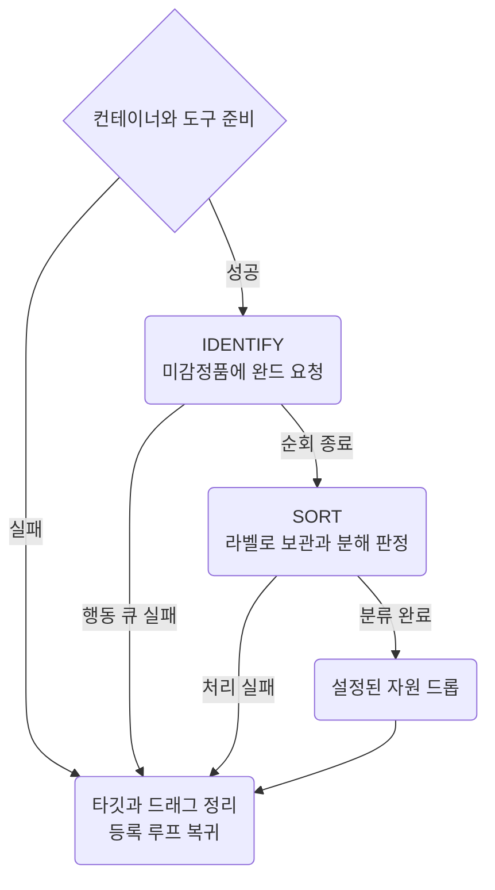

`loot/recycle`의 실행 범위, 감정과 분류, 실패 처리와 복귀 설계.
코드 기준은 [recycle.razor](https://github.com/nomeehej/uoo/blob/master/script/loot/recycle.razor), 실제 관찰과 통과 기준은 [Recycle Checks](../verification/recycle.md).

## 00 한눈에

| 절 | 내용 |
| --- | --- |
| [01](#01) | 준비물과 검색 범위 |
| [02](#02) | 감정 뒤 분류하는 두 단계 |
| [03](#03) | 보관과 분해 판정 |
| [04](#04) | 실패 처리와 등록 루프로 복귀 |
| [05](#05) | 설정, 대기와 상태 |
| [06](#06) | 근거, 검사와 변경 기록 |

## 01 준비와 범위

| 역할 | 기준 |
| --- | --- |
| 감정할 장비 | 백팩 안 루팅 백 `global__my_loot_bag` |
| 보관할 장비 | 백팩 안 보급 파우치 `global__my_supply_pouch`, 안쪽 좌표 `130 200` |
| 감정 도구 | 단일 ID wand `20496`. 완드와 재활용 도구는 백팩에서 검색 |
| 재활용 도구 | tinker tool, sewing kit 또는 saw. 검프가 `Recycle Single Item`일 때만 개별 아이템 지정 |

- 저장된 역할을 우선 사용. 못 찾으면 bag `3702`와 hue 0 pouch `3705`가 각각 하나일 때 임시 사용, global 값은 덮어쓰지 않음
- 두 역할이 같거나 서로 안에 들어 있으면 처리 없이 복귀
- 장비는 루팅 백 안에서만 검색. 보급 파우치의 보관품, 다른 가방과 백팩에 따로 둔 장비는 검사하지 않음
- 보관 기준을 바꿔 재분류할 물건은 루팅 백으로 옮겨 다시 실행
- 두 컨테이너를 처음에 한 번씩 열고 행동 큐 대기. 열기 기한을 넘기면 장비 처리와 자원 드롭 생략

컨테이너 등록과 완드 보급은 [Loadout and Regear](loadout.md).

## 02 감정과 분류

상자 하나 = 전체 품목 순회의 한 단계. 감정 요청을 마친 뒤 분류를 시작하며, 아이템마다 완드와 분해를 교차하지 않음.

| 단계 | 처리 |
| --- | --- |
| IDENTIFY | 라벨에 `unidentified`가 있는 물건만 완드. 완드 뒤 라벨 재조회 없음 |
| SORT | 라벨 한 번으로 보관 또는 분해. 아직 미감정이면 남겨 두고 끝에 `[ unidentified, skip ]` 한 번 |
| DROPS | 장비 처리 실패가 없을 때만 arcane essence 사용과 설정된 자원 드롭 |
| RETURN | 정상 완료와 처리 실패 모두 정리 뒤 등록된 루프 핫키 실행 |

- 완드 더블클릭 간격은 행동 큐의 `ObjectDelay`. 다음 물건의 라벨 조회가 그 사이에 진행
- 선택한 완드와 도구의 serial 재사용. 완드 커서 실패면 그 완드를 이번 실행에서 제외하고 같은 물건에 예비 완드 사용
- 시작할 때 완드가 없으면 복귀. 감정 중 완드를 모두 소진하면 미감정품을 남기고 이미 감정된 품목은 계속 분류
- `getlabel` 자체 대기는 별도. 호출 비용과 대기용으로 쓰면 안 되는 이유는 [Razor](../scripting/razor.md#06) 06절

## 03 보관과 분해

| 판정 | 결과 |
| --- | --- |
| `aspect` 장비 | 항상 보관 |
| `exceptional` 장비 | `config__save_exceptional`이 1이면 보관 |
| 품질 설정에 해당 | 보급 파우치로 이동, 소속을 `find`로 확인하면 다음 아이템 |
| 라벨 응답 없음 | `[ item, skip ]`, 그 물건만 남기고 다음 아이템 |
| 여전히 미감정 | 저품질로 간주하지 않고 루팅 백에 유지 |
| hue 0 주문책 `3834`와 단검 `3922` | 감정과 분해에서 제외, 루팅 백에 유지 |
| 보관 조건에 해당하지 않는 감정품 | 개별 분해, 타깃한 serial이 루팅 백에서 사라졌는지 확인 |

- 검색 목록: 스태프, 쌍수, 투척, 검술, 메이싱, 펜싱, 활, 방패, 마법 장비, 레슬링, 악기, 방어구의 12종. `pushlist` 한 줄에 품목군 하나
- 숫자는 graphic ID. 쌍수와 투척은 이름 검색어와 ID를 함께 사용. 이름과 ID는 [Item list](../game/item-list.md#29) 29절, 방어구는 [02절](../game/item-list.md#02)
- 품질 판정은 무기, 메이싱, 악기, 방패, 방어구의 5종. 검색 대상 220개, 보관 설정 49개
- 방어구 재질은 graphic 방향 대신 라벨로 판정. 같은 graphic ID 여럿도 개별 serial만 ignore해 계속 검색
- 보관품은 루팅 백 밖으로 이동하므로 같은 실행에서 다시 분해하지 않고, 다음 실행에서도 조회 생략

## 04 실패와 복귀

**큐, 이동, 분해를 확인하지 못하면 남은 장비 처리와 자원 드롭 생략.** 다음 실행에서 루팅 백의 남은 물건 재검사.

| 알림 | 처리 |
| --- | --- |
| `[ loot bag, out ]`, `[ supplies, out ]`, `[ loot bag, wrong ]` | 컨테이너 조건 불충족, 아이템 처리 없이 복귀 |
| `[ id wand, wrong ]`, `[ id wand, out ]`, `[ recycle tool, out ]` | 시작의 도구 조건 불충족. 감정 중 완드 소진은 02절 |
| `[ loot bag, blocked ]` | 컨테이너를 연 뒤 큐가 기한 초과 |
| `[ supplies, blocked ]` | 보관 위치로 이동 미확인. 보관품을 분해하지 않음 |
| `[ recycle, wrong ]` | 다른 재활용 모드, 아이템을 지정하지 않음 |
| `[ recycle, blocked ]` | 행동 큐, 검프, 커서 또는 분해 결과 미확인. 같은 아이템의 기한 초과를 반복하지 않음 |

- `var__running 0`으로 이번 정리 종료. 공통 RETURN 경로에 `stop` 없음
- `clearall`, 분해 검프 닫기, `clearignore` 뒤 `list__resume_script`의 각 핫키 실행
- `clearall`은 타깃과 타깃 큐 취소, 드래그 큐 정리, 들고 있는 물건의 백팩 반환 요청. 서버에 이미 보낸 모든 요청의 취소를 보장하지 않음
- 정리 뒤 `queued`가 남아도 복귀 핫키 실행. 실제 반환과 복귀 성공은 [Recycle Checks](../verification/recycle.md#01) 01절

#### 복귀할 루프 선택

- 사냥과 채집 레시피가 Play할 때 `list__resume_script`를 비우고 자신의 Razor 핫키 이름 한 개 등록. 예: `Play Script: gather\skinning-enhanced`
- Bard Wrestling과 Tamer Archer도 같은 방식으로 등록. 현재 이름은 각 `recipe/*-recipe.razor`의 setup, archive의 bard-mace와 bard-throwing은 archive 이름 사용
- 목록은 클라이언트 종료까지 유지. `combat/pvp`는 등록하지 않으므로 pvp 중 recycle도 마지막에 등록한 사냥이나 채집 루프로 복귀
- 등록이 없으면 recycle만 종료. 문자열을 변수 대신 리스트에 보관하는 이유는 [Razor](../scripting/razor.md#03) 03절

## 05 설정과 상태

설정은 단독 스크립트 [CONFIG](https://github.com/nomeehej/uoo/blob/master/script/loot/recycle.razor#L15)에 보관. 모든 품목군이 감정, 이동, 분해 코드를 공유.

| 설정 | 기준 |
| --- | --- |
| `config__chatty` | 선택적 알림. 경고는 설정과 무관하게 표시 |
| `config__sysmsg` | 기본 0. 1이면 아이템별 검사와 저장 Journal |
| `config__save_*` | 품질과 재질별 보관 조건 |
| `config__drop_*` | 마지막에 백팩 전체에서 자원 검색, 발밑 드롭. 드롭 거절 문장 뒤 백팩 복구 요청 |
| `config__drink_arcane_essence` | 장비 처리 뒤 arcane essence 사용 |
| `wait__poll` | 50ms, 행동 큐와 이동, 분해 결과 재확인 간격 |
| `wait__target` | 500ms, 도구 커서 대기 상한 |
| `wait__timeout` | 5000ms, 행동 큐와 검프, 이동, 분해 결과 대기 상한 |
| `wait__drop` | 650ms, 자원 드롭 거절 문장을 읽기 전 대기 |

대기 값은 스크립트 설정. 서버 쿨다운이나 실측 처리 속도가 아님. `timer__recycle` 하나를 단계마다 초기화.

| 상태 | 이름 |
| --- | --- |
| 컨테이너 | `var__loot_bag`, `var__supply_pouch` |
| 도구 | `var__id_wand`, `var__id_wand_out`, `var__tool` |
| 처리 | `var__running`, `var__item_pending`, `var__unidentified_left`, `var__keep`, `var__kind`, `var__slayer`, `var__armor_type` |

`ignore`는 이번 실행의 재선택 방지용. 시작과 끝, 두 순회 사이에 초기화.

::part[기록]

## 06 근거와 검사

- [Recycle Checks](../verification/recycle.md): 실제 관찰, 실패 조건과 복귀 검사의 확인 상태
- [Verification History](../history/verification.md#06) 06절: 검색 범위 축소와 두 단계 감정으로 바뀐 경과
- [공식 Recycling](https://wiki.uooutlands.com/Recycling), 2026-10-21 기록: 개별 분해 모드 권장. 다른 모드는 백팩의 유용한 장비까지 대상이 될 수 있음
- 검프 문구 `Recycle Single Item` 선례: [Bapeths Slower Item Recycler](https://outlands.uorazorscripts.com/script/752d1745-90d4-4078-a8cb-8ce2cccef3e0)
- `clearall` 근거, 2026-10-21 기록: [CE clearall](https://www.razorce.com/guide/commands/#clearall),
  [ClearAll 구현](https://github.com/markdwags/Razor/blob/master/Razor/Scripts/Commands.cs),
  [DropCurrent 구현](https://github.com/markdwags/Razor/blob/master/Razor/Core/ActionQueue.cs)
- 기존 정적 동일성 검사와 모의 실행은 실패 분기의 복귀 경로 확인용. 실제 큐 정리, 아이템 반환과 핫키 동작의 근거는 위 검사표
